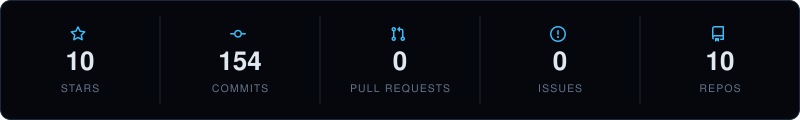
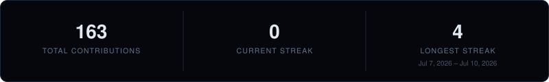

  

  <a href="https://begoneeraj.github.io"><strong>Portfolio ↗</strong></a>
  &nbsp;&nbsp;·&nbsp;&nbsp;
  <a href="mailto:pushprajsingh2007prashant@gmail.com"><strong>Get in touch ↗</strong></a>
  &nbsp;&nbsp;·&nbsp;&nbsp;
  <a href="https://github.com/begoneeraj?tab=repositories"><strong>All repositories ↗</strong></a>

 

## Hey, I'm Pushpraj.

I build across **AI, web, and mobile** — from checking news claims to connecting hospital workflows and turning everyday tasks into a game. I like owning the whole build: the interface, the API, the database, and the details that make them work together.

Python for AI and backend work. TypeScript for the web. Flutter when the idea belongs on a phone.

**Open to internships, freelance work, and collaborations.**

 

## Selected work

<table>
  <tr>
    <td width="50%" valign="top">
      01 / AI + MOBILE
      <h3><a href="https://github.com/begoneeraj/Newsup">TruthLens India ↗</a></h3>
      
AI-assisted fact-checking and crisis tracking for Indian news. Brings claims, evidence, and ongoing institutional stories into a Flutter app.

      
<code>Flutter</code> <code>Python</code> <code>Supabase</code>

      
<a href="https://github.com/begoneeraj/Newsup">Explore code</a> · <a href="https://github.com/begoneeraj/Newsup/releases">Android releases</a>

    </td>
    <td width="50%" valign="top">
      02 / HEALTHCARE + WEB
      <h3><a href="https://github.com/begoneeraj/MediConnect">MediConnect ↗</a></h3>
      
A hospital coordination platform with bed management, patient records, and emergency workflows, plus an interactive demo sandbox.

      
<code>Next.js</code> <code>TypeScript</code> <code>PostgreSQL</code>

      
<a href="https://github.com/begoneeraj/MediConnect">Explore code</a>

    </td>
  </tr>
  <tr>
    <td width="50%" valign="top">
      03 / PRODUCTIVITY + PLAY
      <h3><a href="https://github.com/begoneeraj/Life-rpg">Life RPG ↗</a></h3>
      
Everyday tasks become quests with XP, gold, and character progression. Rewards and leveling run on the server, with guards against double claims.

      
<code>React</code> <code>Express</code> <code>Prisma</code>

      
<a href="https://github.com/begoneeraj/Life-rpg">Explore code</a>

    </td>
    <td width="50%" valign="top">
      04 / PHOTO METADATA
      <h3><a href="https://github.com/begoneeraj/decoy-drop">Decoy Drop ↗</a></h3>
      
A local toolkit for inspecting photo metadata and experimenting with GPS geotags. Interactive maps, EXIF extraction, and photo processing on your machine.

      
<code>JavaScript</code> <code>Express</code> <code>Leaflet</code>

      
<a href="https://github.com/begoneeraj/decoy-drop">Explore code</a>

    </td>
  </tr>
</table>

 

## What I build with

| Area | Tools |
| :--- | :--- |
| **Languages** | Python · TypeScript · JavaScript · Dart |
| **Interfaces** | React · Next.js · Flutter · Tailwind CSS |
| **Backend & data** | Node.js · Express · PostgreSQL · Supabase · Prisma |
| **AI** | Groq · Llama |

 

  
<strong>A little more GitHub activity</strong>

   
  
   
  

 

---

  <strong>Have something worth building?</strong> 
  <a href="mailto:pushprajsingh2007prashant@gmail.com">Let's talk</a> · <a href="https://begoneeraj.github.io">See more of my work</a>

